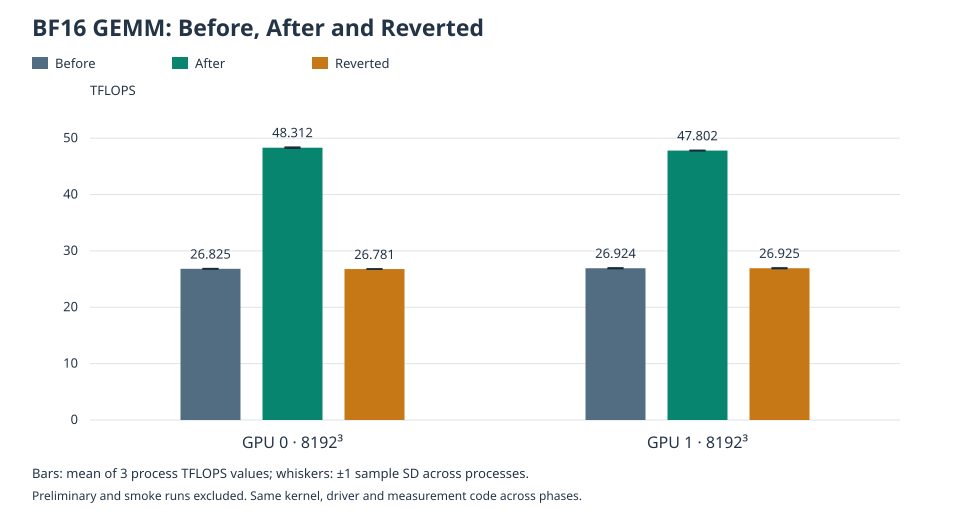
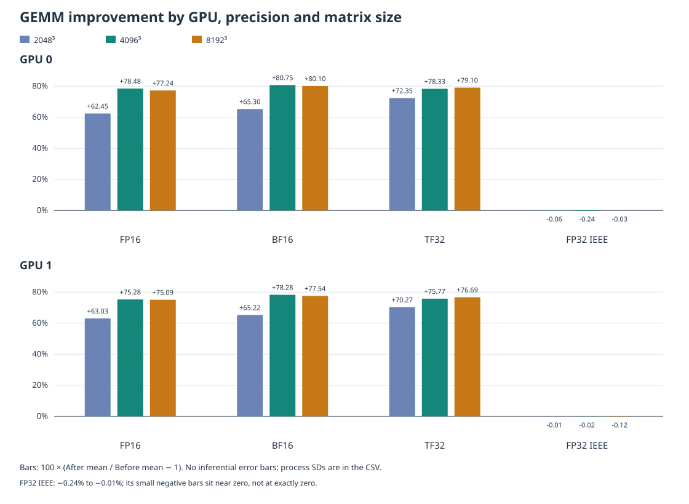
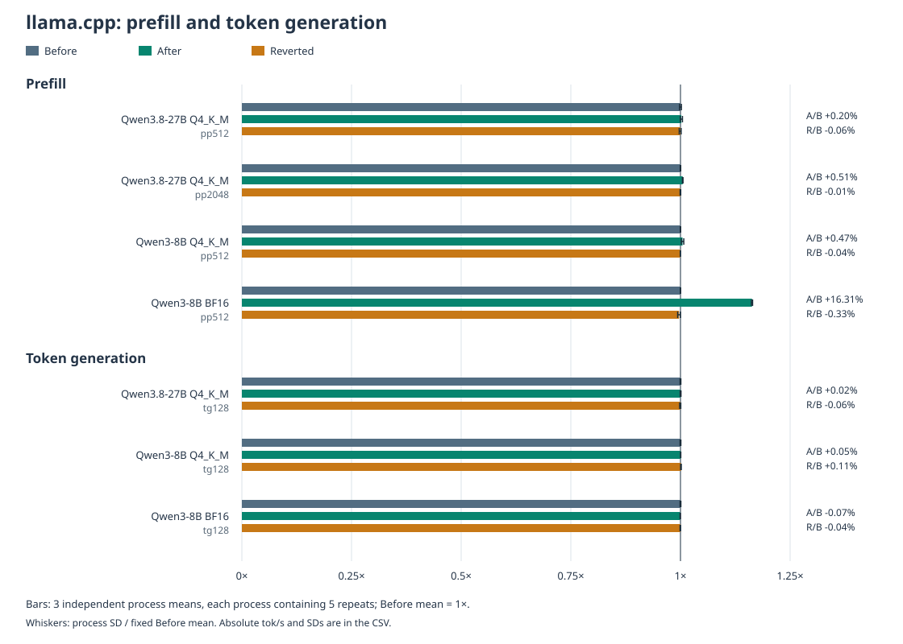

# GPU-Unlock 2.0.0 on two RTX 3060 GPUs: Before, After and Reverted

This diagnostic experiment measured two RTX 3060 12 GB GPUs under Proxmox PCI
passthrough. **BF16 GEMM improved by 65–81% across the tested configurations,
reaching approximately 80% at 8192³.** FP16 and TF32 also improved substantially.
Qwen3-8B BF16 pp512 improved by 16.31%; quantized prefill and token generation
changed much less. Reverted measurements returned close to Before.

These are measurements from one host, not a performance or safety guarantee.
`baseline_eligible=false` remains unchanged: the formal baseline-admission and
evidence-certification system is incomplete, so these runs are recorded as
diagnostic experiments. Successful benchmarks and formal evidence admission
are different things.

## Main observations

| Metric | Before | After | Reverted | Unit |
| --- | ---: | ---: | ---: | --- |
| GPU 0, BF16 8192³ | 26.825 | 48.312 | 26.781 | TFLOPS |
| GPU 1, BF16 8192³ | 26.924 | 47.802 | 26.925 | TFLOPS |
| Qwen3-8B BF16, pp512 | 1766.60 | 2054.72 | 1760.83 | tok/s |

Each value is the mean of **three independent process statistics**. Full
precision, process-level values and sample standard deviations are in the
linked CSVs below; displayed values are rounded only for presentation.



After / Before improvements across GPU and matrix-size configurations:

| Precision | Observed range |
| --- | ---: |
| FP16 | +62.45% to +78.48% |
| BF16 | +65.22% to +80.75% |
| TF32 | +70.27% to +79.10% |
| FP32 IEEE | **−0.24% to −0.01%** |

FP32 IEEE was slightly lower in every tested configuration. These observed
changes were very small; they were not exactly zero. We do not claim statistical
significance, or attribute these small decreases to temperature, power or clock
changes without an experiment that isolates those factors.

Reverted / Before was −0.48% to +0.33% across all 24 GEMM configurations.

## Hardware and software

| Component | Recorded configuration |
| --- | --- |
| GPUs | 2 × NVIDIA GeForce RTX 3060 12 GB, GA106, PCI device ID `10de:2504` |
| CPU | AMD Ryzen 9 5900X |
| Virtualization | Proxmox VE, PCI passthrough |
| Guest | Ubuntu 24.04, kernel `6.8.0-147-generic` in all three phases |
| NVIDIA driver | `580.178.04` |
| GPU-Unlock | `2.0.0`, tested upstream commit `1fc6d628c49c7fba34ef3a2e7f758700d35ce890` |
| GEMM code | Measurement snapshot `9bab18fab9d986b61f90287d4eadeadf9f66c41a` |
| Python / PyTorch | Python `3.12.3`; PyTorch `2.11.0+cu128` |
| llama.cpp | Build `11669`, binary-reported commit `620d2225c`, GNU `13.3.0` |
| Power limit | 170 W per GPU, unchanged |

GPU identity verified across phases. Public data identify the devices only as
GPU 0 and GPU 1. For this topology, host PCI addresses were `0000:03:00.0` and
`0000:09:00.0`; guest addresses were `0000:00:10.0` and `0000:00:11.0`.
GPU 0 was reported as ZOTAC; the second board vendor was not independently
established. GPU 0 had host `boot_vga=1`, yet both cards reported a successful
unlock. That flag alone does not establish the complete UEFI initialization
history, or guarantee that other display-GPU configurations will work.

### Three distinct CUDA version statements

1. **Driver compatibility:** the saved `nvidia-smi` output displayed CUDA 13.0.
   This describes driver compatibility, not the runtime linked into a workload.
2. **GEMM workload:** PyTorch `2.11.0+cu128` reports CUDA 12.8. The archived
   runtime query also returned 12.8. Recorded Python-package metadata includes
   `nvidia-cuda-runtime-cu12=12.8.90` and `nvidia-cublas-cu12=12.8.4.1`.
3. **llama.cpp build:** archived CMakeCache records report CUDA Toolkit
   **12.8.61**, including a CUDA 12.8 compiler location. The saved binary version
   output records GNU 13.3.0. This conclusion comes from saved build records,
   not a current compiler invocation or the current CUDA directory link.
   Archived runtime resolution also reports CUDA runtime 12.8.

Additional recorded package versions are in
[the environment summary](data/gpu-unlock-environment.json). Package-version
records and a toolkit detection record are not interchangeable. In particular,
12.8.61 describes the saved build-toolkit detection; 12.8.90 is a Python runtime
package version. External runtime-file hashes were recorded in After and checked
again in Reverted; an equivalent external-file inventory was not captured in
Before. Do not infer an independently verified historical hash for every library.

Measurements were performed using commit `9bab18f`. The published source is
based on that snapshot, with only the default Python interpreter path adjusted
for portability. The default is `PYTHON=${PYTHON:-python3}`. Activate the
measurement venv or set `PYTHON` to the appropriate interpreter; the default
alone does not select the original Python environment. Measurement logic,
arguments, precision validation and telemetry processing are unchanged.

## Experimental phases and provenance

| Phase | Loaded module | `targets` | Boot success messages | Boot procedure |
| --- | --- | --- | --- | --- |
| Before | 2.0.0 | `(null)` | No per-GPU application success message | Normal boot |
| After | 2.0.0 | `all` | `unlocked` for both GPUs | Operator-reported host shutdown and AC power removal |
| Reverted | 2.0.0 | `(null)` | No application success message in that boot | Operator-reported host shutdown and AC power removal |

Selected After evidence, with unrelated log fields omitted:

```text
pci 0000:00:10.0: gpu_unlock: unlocked
pci 0000:00:11.0: gpu_unlock: unlocked
```

Both handoffs recorded `ret=0 state=4`, and NVIDIA subsequently recognized both
cards. The operator performed the AC interruption; it was not independently
verified by an electrical measurement. We did not assume that a guest reboot
or a PCI reset alone clears the GPU state. Reverted performance supports
functional reversibility under these conditions, not complete restoration of
every internal hardware state.

An older Before session used kernel 6.8.0-107-generic. Before was repeated on
147 so that the formal numerical comparison uses only 147. The 107 data are
historical context and are excluded from every published comparison here.

The operator reported re-enabling GPU-Unlock after Reverted. That later boot
is outside the measured three-phase sequence and was not used as another After
sample. Preparing this report did not change GPU settings or run benchmarks.

## GEMM method and complete results

Each phase contains 24 configurations × 3 independent processes = 72 results:
two GPUs; FP16, BF16, TF32 and FP32 IEEE; square sizes 2048, 4096 and 8192.
Execution order is **round → GPU → precision → size**, with one GPU running at
a time. No retry was selected to replace an unfavorable result.

The unchanged runner used a three-second warmup, at least two seconds of measured
GPU time, a 5% calibration headroom, target-GPU starting temperature ≤50 °C,
up to 180 seconds of passive cooldown, and contention, memory and identity
checks. Pre- and post-measurement numerical validation passed for all **216**
GEMM processes across the three phases; no duration shortfall occurred.

FP16 accumulation and reduced-precision FP16/BF16 reductions were disabled in
the recorded PyTorch policy. TF32 enabled the TF32 matmul policy; FP32 IEEE
disabled it. These settings and the validation policy were unchanged across
phases. They are software configuration evidence, not a direct instruction-level
trace of every operation or a bit-for-bit equality test of every output element.

Each process reports TFLOPS from its median measured operation latency.
The table averages those **three process statistics**, with sample SD
(`ddof=1`) across the three. It does not pool all CUDA events into independent
experimental replicates. A recorded zero SD means the three saved process
statistics were identical, not that the hardware has no noise.

Units below are TFLOPS. Percent changes are ratios of unrounded process means.

<!-- GEMM_TABLE_START -->

| GPU | Precision | Size | Before mean ± SD | After mean ± SD | Reverted mean ± SD | After / Before | Reverted / Before |
| --- | --- | --- | --- | --- | --- | --- | --- |
| 0 | BF16 | 2048 | 24.457 ± 0.036 | 40.427 ± 0.097 | 24.457 ± 0.062 | +65.30% | +0.00% |
| 0 | BF16 | 4096 | 25.823 ± 0.027 | 46.674 ± 0.108 | 25.841 ± 0.073 | +80.75% | +0.07% |
| 0 | BF16 | 8192 | 26.825 ± 0.038 | 48.312 ± 0.093 | 26.781 ± 0.013 | +80.10% | -0.16% |
| 0 | FP16 | 2048 | 24.493 ± 0.094 | 39.788 ± 0.055 | 24.374 ± 0.164 | +62.45% | -0.48% |
| 0 | FP16 | 4096 | 25.976 ± 0.117 | 46.362 ± 0.028 | 25.938 ± 0.170 | +78.48% | -0.15% |
| 0 | FP16 | 8192 | 26.756 ± 0.112 | 47.424 ± 0.186 | 26.844 ± 0.085 | +77.24% | +0.33% |
| 0 | FP32 IEEE | 2048 | 7.374 ± 0.002 | 7.369 ± 0.002 | 7.375 ± 0.006 | -0.06% | +0.01% |
| 0 | FP32 IEEE | 4096 | 7.506 ± 0.001 | 7.489 ± 0.017 | 7.497 ± 0.018 | -0.24% | -0.13% |
| 0 | FP32 IEEE | 8192 | 9.496 ± 0.003 | 9.493 ± 0.009 | 9.498 ± 0.003 | -0.03% | +0.02% |
| 0 | TF32 | 2048 | 12.032 ± 0.022 | 20.738 ± 0.000 | 12.022 ± 0.020 | +72.35% | -0.08% |
| 0 | TF32 | 4096 | 12.949 ± 0.014 | 23.092 ± 0.009 | 12.933 ± 0.009 | +78.33% | -0.12% |
| 0 | TF32 | 8192 | 13.334 ± 0.003 | 23.880 ± 0.001 | 13.350 ± 0.034 | +79.10% | +0.12% |
| 1 | BF16 | 2048 | 24.327 ± 0.041 | 40.193 ± 0.069 | 24.310 ± 0.037 | +65.22% | -0.07% |
| 1 | BF16 | 4096 | 26.015 ± 0.051 | 46.378 ± 0.000 | 26.011 ± 0.053 | +78.28% | -0.01% |
| 1 | BF16 | 8192 | 26.924 ± 0.060 | 47.802 ± 0.047 | 26.925 ± 0.061 | +77.54% | +0.00% |
| 1 | FP16 | 2048 | 24.268 ± 0.020 | 39.564 ± 0.008 | 24.221 ± 0.040 | +63.03% | -0.19% |
| 1 | FP16 | 4096 | 26.123 ± 0.009 | 45.787 ± 0.050 | 26.063 ± 0.056 | +75.28% | -0.23% |
| 1 | FP16 | 8192 | 26.779 ± 0.082 | 46.888 ± 0.129 | 26.736 ± 0.039 | +75.09% | -0.16% |
| 1 | FP32 IEEE | 2048 | 7.346 ± 0.000 | 7.345 ± 0.000 | 7.343 ± 0.002 | -0.01% | -0.03% |
| 1 | FP32 IEEE | 4096 | 7.475 ± 0.001 | 7.474 ± 0.002 | 7.474 ± 0.001 | -0.02% | -0.01% |
| 1 | FP32 IEEE | 8192 | 9.438 ± 0.012 | 9.427 ± 0.019 | 9.414 ± 0.002 | -0.12% | -0.25% |
| 1 | TF32 | 2048 | 12.119 ± 0.027 | 20.636 ± 0.025 | 12.125 ± 0.013 | +70.27% | +0.05% |
| 1 | TF32 | 4096 | 13.039 ± 0.034 | 22.920 ± 0.000 | 13.002 ± 0.025 | +75.77% | -0.28% |
| 1 | TF32 | 8192 | 13.345 ± 0.013 | 23.580 ± 0.081 | 13.339 ± 0.020 | +76.69% | -0.04% |

<!-- GEMM_TABLE_END -->



Data: [24-configuration comparison](data/gpu-unlock-gemm-comparison.csv) ·
[216 sanitized process records](data/gpu-unlock-gemm-processes.csv).
The comparison CSV also contains accuracy pass counts, phase-specific process
counts, temperature, power, SM/memory clocks, and observed clock-limit fractions.

## llama.cpp method and complete results

Per phase, the three models produced 21 independent processes and 105 repeats:

- Qwen3.8-27B Q4_K_M: `pp512 → tg128 → pp2048`, three rounds.
- Qwen3-8B Q4_K_M: `pp512 → tg128`, three rounds.
- Qwen3-8B BF16: `pp512 → tg128`, three rounds.

Every process used five internal repeats. The aggregate unit is still the
**independent process**: means and sample SDs below are computed from three
saved `avg_ts` values. Individual `samples_ts` values are preserved at their
original saved precision, but their rounded display values are not used to
reconstruct process means or SDs. We do not treat 15 repeats as 15 independent
processes. All 63 full processes across the three phases completed successfully.

The same binaries, shared libraries, GGUF files, execution order and environment
were checked internally. Numerical GEMM validation and a successful llama-bench
run are different checks; we did not perform a separate generated-text equality
test for these language-model sessions.

Settings: `CUDA0/CUDA1`, tensor split mode, ratio `1/1`, main GPU 0, GPU layers
99, FlashAttention on, K/V caches `q8_0`, batch 2048, ubatch 512, eight threads,
depth 0, KV offload enabled, automatic loading and lazy-loading, repacking on.
The actual split argument uses `1/1`; the JSON reports `1.00/1.00`.

```sh
export CUDA_DEVICE_ORDER=PCI_BUS_ID
export CUDA_VISIBLE_DEVICES=0,1
export GGML_CUDA_ALLREDUCE=internal
export LD_LIBRARY_PATH="${CUDA_LIB_DIR}"
llama-bench -m "${MODEL_GGUF}" -p 512 -n 0 -r 5 -o json \
  -dev CUDA0/CUDA1 -sm tensor -ts 1/1 -mg 0 -ngl 99 \
  -ctk q8_0 -ctv q8_0 -fa on -b 2048 -ub 512 -t 8 -d 0 \
  -nkvo 0 -lm auto -lzm auto --repack 1
```

The variables above are portable placeholders, not original private locations.
For `tg128`, use `-p 0 -n 128`; for `pp2048`, use `-p 2048 -n 0`.
There was no direct context-length argument: prompt, generated tokens and depth
determined the requested context. Effective padding can differ internally.
No speculative decoding was used. The build had NCCL support, but the measured
environment selected the internal all-reduce implementation.

Units below are tok/s; mean ± SD across three independent process means.

<!-- LLAMA_TABLE_START -->

| Model | Quantization | Test | Before mean ± SD | After mean ± SD | Reverted mean ± SD | After / Before | Reverted / Before |
| --- | --- | --- | --- | --- | --- | --- | --- |
| Qwen3-8B | BF16 | pp512 | 1766.596 ± 0.255 | 2054.720 ± 2.358 | 1760.825 ± 5.454 | +16.31% | -0.33% |
| Qwen3-8B | BF16 | tg128 | 39.200 ± 0.035 | 39.173 ± 0.009 | 39.183 ± 0.019 | -0.07% | -0.04% |
| Qwen3-8B | Q4_K_M | pp512 | 2132.065 ± 0.529 | 2142.035 ± 6.090 | 2131.113 ± 0.163 | +0.47% | -0.04% |
| Qwen3-8B | Q4_K_M | tg128 | 94.873 ± 0.085 | 94.925 ± 0.019 | 94.973 ± 0.072 | +0.05% | +0.11% |
| Qwen3.8-27B | Q4_K_M | pp2048 | 735.759 ± 0.403 | 739.538 ± 0.439 | 735.659 ± 0.523 | +0.51% | -0.01% |
| Qwen3.8-27B | Q4_K_M | pp512 | 751.673 ± 1.539 | 753.214 ± 1.850 | 751.188 ± 1.604 | +0.20% | -0.06% |
| Qwen3.8-27B | Q4_K_M | tg128 | 28.917 ± 0.025 | 28.923 ± 0.027 | 28.899 ± 0.038 | +0.02% | -0.06% |

<!-- LLAMA_TABLE_END -->



Data: [seven-condition comparison](data/gpu-unlock-llama-comparison.csv) ·
[63 sanitized process records](data/gpu-unlock-llama-processes.csv).
The process CSV includes per-GPU telemetry summaries; no private log or input
location is copied into the public data.

## Power, clocks and thermal observations

The 170 W power limit was unchanged. For BF16 8192³, mean SM clocks were about
1915/1919 MHz Before, 1739/1728 MHz After, and 1912/1917 MHz Reverted, respectively
for GPU 0 / GPU 1. Mean power changed from about 147/166 W to 170/170 W, then
146/166 W. After recorded software power-cap events throughout the sampled
BF16 8192³ measured intervals; Before and Reverted did not in those intervals.
Mean measured temperatures were approximately 60.2/69.4 °C, 62.0/69.2 °C and
60.7/70.0 °C. The higher After throughput was therefore not accompanied by a
simple increase in observed SM clock.

The highest sampled GEMM measured-phase temperature in After was 72 °C; the
highest sampled power was 170.327 W. Small instantaneous power readings above
the nominal limit are not a changed configured limit. No thermal-slowdown
sample was observed in the GEMM measured intervals. These samples do not rule
out every shorter event between polls.

After's 8B Q4 `tg128` second process recorded four software thermal-slowdown
samples on GPU 1, alongside software power-cap flags. They occurred in the
monitor's final approximately 0.30-second span, starting about 0.46 seconds
after the result output was written, consistent with post-measurement cleanup.
We retain the observation and do not prove zero impact on every internal
operation. Hardware thermal-slowdown was not active. No such thermal flag was
recorded in Reverted. The tiny Q4 generation difference is not interpreted as
a reliable throughput improvement.

GEMM telemetry summaries cover the timed GEMM phase. llama.cpp telemetry spans
the whole process, including model loading and warmup, but excludes passive
cooldown. Those scopes must not be conflated. CUDA errors, Xid events and
competing compute processes were not detected in the validated runs; polling
cannot establish perfect isolation.

## Interpretation: observations versus explanations

**Observed:** FP16, BF16 and TF32 GEMM improved substantially, while FP32 IEEE
showed the small negative range specified above. This is consistent with a
benefit to tensor-math paths rather than general FP32 IEEE throughput. It does
not independently establish every GPU-internal implementation detail.

On this GA106 setup, FP16 improvements were also large and close to BF16's
range. We do not generalize that relationship to other GPU models or compare
it directly with a different card's headline number under different conditions.

Earlier, separate diagnostic profiles using the same llama.cpp binary observed
quantized MMQ kernels for Q4_K_M and BF16 tensor-GEMM kernels on both devices for
BF16 prefill. Those profiles were outside these 147 performance sessions and
are not additional performance samples. Source analysis at the pinned llama.cpp
revision supports different dispatch for quantized MMQ and large unquantized
BF16 operations; it does not prove that every operation in every phase took a
particular path. See the pinned
[MMQ dispatch source](https://github.com/ggml-org/llama.cpp/blob/620d2225cc436ab0b001e3200e590e3b286ef9ab/ggml/src/ggml-cuda/mmq.cu)
and [CUDA backend source](https://github.com/ggml-org/llama.cpp/blob/620d2225cc436ab0b001e3200e590e3b286ef9ab/ggml/src/ggml-cuda/ggml-cuda.cu).

**Plausible explanations, not isolated causal measurements:** quantized MMQ work
does not necessarily benefit in the same way as floating-point tensor GEMM.
BF16 prefill also includes attention, memory movement, GPU communication,
synchronization and other work. Its 16.31% gain need not match a large isolated
GEMM gain. Generation's arithmetic-to-memory ratio can make bandwidth and
per-token overhead more important. We did not collect bandwidth counters or
an end-to-end profile in all three sessions to quantify these contributions.

The observed 170 W cap and lower After clocks are consistent with a power
constraint limiting the realized tensor-math gain. We did not change the power
limit or lock clocks to isolate that hypothesis. Returning near Before in
Reverted strengthens the interpretation of a reversible performance effect,
but unchanged FP32 alone is not proof of causality.

## Limitations

1. One host and two RTX 3060 GPUs were tested.
2. This is a Proxmox PCI-passthrough setup, not a general bare-metal survey.
3. Before, After and Reverted each represent one session.
4. Three independent processes within a session are not independent days or
   independently repeated experimental sessions. No significance or equivalence
   test is claimed from these descriptive statistics.
5. GPU power limits were approximately 170 W.
6. AC interruption is based on the operator's procedure, not independent
   electrical instrumentation.
7. Before was a normal boot; After and Reverted followed operator-reported host
   cold boots. That is a real procedural difference.
8. Reverted returning near Before supports a small influence of that procedural
   difference here, but does not prove perfectly matched conditions.
9. The older kernel-107 Before was replaced by a kernel-147 Before for the formal
   comparison. Kernel-107 values are not included in the published aggregates.
10. Complete restoration of every internal GPU state has not been demonstrated.
11. Long-term stability, hardware safety and applicability to other GPUs are not
    guaranteed.
12. Results may depend on the particular driver, CUDA, PyTorch and llama.cpp
    versions, as well as unmeasured host load or cooling history.

## Public data, regeneration and privacy

The public schema exports only explicitly selected measurement values and
generic configuration labels. Raw logs and private identity fields are not
published. Identity matching was performed internally across the three phases.
Original evidence remains private and unchanged.

Regenerate the public summaries, Markdown tables and figures without a GPU or
third-party Python package:

```sh
python3 scripts/publish_gpu_unlock_results.py
python3 scripts/render_gpu_unlock_results.py
```

The first command re-aggregates the published process CSVs; it does not require
private source data. Optional private-input arguments are available for the
maintainer to repeat the allowlisted extraction. Neither script imports the
measurement code, imports PyTorch, invokes CUDA, installs packages or modifies
the measurement environment. The measurement environment and CUDA package holds
were checked before and after publication preparation.

## Acknowledgements and risk

Thanks to [Zagitta and the GPU-Unlock contributors](https://github.com/Zagitta/gpu-unlock)
for making this experiment possible. The tested upstream revision is recorded
above; current upstream guidance can change independently of that revision.

GPU-Unlock is unofficial and changes GPU firmware/hardware state. Use entails
risk; these measurements are not a hardware-safety endorsement or a deployment
recommendation. We did not test long-term reliability.
